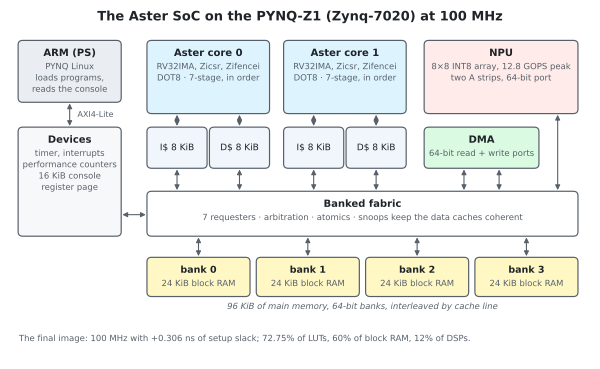
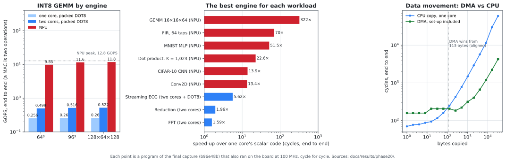

# Aster

**A two-core RISC-V SoC with an INT8 neural-network accelerator, designed and verified from scratch, running on a
PYNQ-Z1 FPGA at 100 MHz.**



## Performance at a glance

Measured at 100 MHz on the final SoC, end to end unless marked. Every figure is a program that also ran on the
board, cycle for cycle as in simulation.

| Engine or workload | Result |
| --- | --- |
| NPU, INT8 GEMM 128×64×128 | **11.8 GOPS** end to end; 59.3 MACs a cycle in the kernel, 93% of its 12.8 GOPS peak |
| One Aster core | **CoreMark 2.19/MHz** (218.7 at 100 MHz): the official 2K performance and validation runs, validated on the board |
| Two cores, DOT8 GEMM | 0.52 GOPS, 1.95–2.01× one core |
| DMA | 771 MB/s on a 32 KiB copy, 14× a core's copy; it wins from 113 bytes |
| MNIST MLP on the NPU | 18,560 images/s one at a time; 65,200/s in batches of 32 |
| CIFAR-10 CNN on the NPU | 890 images/s |
| Streaming ECG | 3.1 million samples/s; worst chunk latency 53 µs, against a 178 ms deadline |
| The best engine against one core | **13× to 322×** on the NPU's workloads at the sizes in the results figure; 5.6× on streaming ECG; 1.6× to 2.0× on two cores where no engine applies |
| The FPGA build | 100 MHz with +0.306 ns of setup slack; 72.75% of LUTs, 60% of block RAM, 12% of DSPs |

## What this project is about

Aster asks one question: **for the same work, where should it run?** The candidates are:
- one CPU core;
- two cores;
- a custom dot-product instruction (DOT8);
- a DMA engine;
- an 8×8 INT8 NPU.

Answering that fairly takes more than an accelerator. So Aster built every part of the system itself, and measured
every engine on equal terms:
- **its own CPU:** the Aster core, a seven-stage in-order RV32IMA core with Zicsr, Zifencei and DOT8. It is checked
  in lockstep against Spike on every instruction. It takes 3.68× fewer cycles than PicoRV32, a widely used
  open-source RISC-V core, on the same CPU programs (the geometric mean over seven kernels);
- **an NPU that is fed:** an 8×8 array with two operand strip buffers and a 64-bit port, which keeps its PEs busy on
  real shapes;
- **a coherent two-core SoC:** private 8 KiB instruction and data caches with snooping, a four-bank 96 KiB memory
  behind a fabric with atomics, a 64-bit DMA, and the NPU, all on one 100 MHz clock;
- **a fair measurement method:**
  - every engine runs on the same image, the same inputs and the same clock;
  - each runs on two windows: the kernel alone, and end to end with set-up, data movement and joins;
  - every result is checked against an independent reference;
  - small jobs where an engine loses stay in the results.

## The workloads

A workload matrix runs every workload with every method that applies, across the SoC's configuration axes: 26,186
configurations, 23,932 runs and 32,918 AsterBench records.

| Family | Workloads | Methods |
| --- | --- | --- |
| CPU | CoreMark, Dhrystone, sort/search, FFT, strided reads, Conv2D | one core |
| Memory | memcpy, sequential, strided and random walks, a working-set sweep, two-hart streams in the same or different banks | one and two cores |
| Coherence | Reductions, a two-core DOT8 GEMM, atomic counters (amoadd, lr/sc, CAS), a lock-protected sum, false sharing and its padded control, a shared mix, dispatch and join | one and two cores, DOT8 |
| DSP | Dot product (K = 0 to 4,096), FIR (4 to 256 taps), FFT, Conv2D (direct and im2col) | scalar, two cores, DOT8, NPU |
| ML | MNIST MLP (784→32→10, one at a time and batched), CIFAR-10 CNN | scalar, two cores, DOT8, NPU |
| Streaming ECG | A real MIT-BIH segment, filtered and classified chunk by chunk | one core, DOT8, and a pipeline of the DMA, a DOT8 filter and the NPU's classifier, sequential or overlapped on two harts |
| DMA | Copies of 0 to 32 KiB at several alignments, the destination cached or not, and beside other work | CPU copy, DMA |
| NPU GEMM | 40 shapes from 1×1×1 to 128×64×128, matrix-vector included | scalar, DOT8, two cores, NPU |

**The axes:**
- memory latency (+1, +2, +4 waits);
- cache size (2, 4, 8 KiB);
- the data cache on or off;
- one or two harts;
- NPU geometry (4×4 or 8×8, 32- or 64-bit port, one or two strips);
- input seeds;
- cold or warm caches.

Every program at the reference configuration, all 5,254 of them, was also run on the board.

## The questions it answers

[The report](docs/phase20-report.md) answers each from the final data, losses included.

1. **When does one core, two cores, DOT8, the DMA or the NPU win?**
   - The NPU wins every INT8 matrix workload, from a 1×1×1 GEMM up.
   - On the largest GEMMs (64³ to 128×64×128) it is 19.7× to 22.6× faster than the best CPU code: packed DOT8 on
     two cores.
   - A scalar loop wins only the tiniest dot products.
   - Where no engine applies, two cores win: 1.59× on the FFT and 1.96× on the parallel reduction.
2. **How do working set, access pattern, bank conflicts and memory latency affect throughput?**
   - A working set past the 8 KiB data cache costs 18%, and a strided read of a new line each time 46–48%.
   - Bank conflicts cost at most 2.3%.
   - Each added memory wait costs one core and DOT8 under 2%, two cores about 5%, and the NPU and the DMA 15–21%.
3. **What do cache capacity and coherence cost?**
   - Halving the caches to 4 KiB costs 0.4–2.7%; 2 KiB costs up to 16.5% a family and 1.95× in one case.
   - Atomic counters scale 1.8–1.95× on two cores at 1,024 items, but lose at 2 items, where starting and joining
     hart 1 costs about 500 cycles.
   - A lock-protected sum never scales.
4. **When does the DMA beat a CPU copy, and does it free the CPU?**
   - The DMA wins from 113 bytes aligned (61 to 89 bytes unaligned) and reaches 7.99 bytes a cycle.
   - Yes, it frees the CPU: a copy hides behind other work, saving up to 47%.
5. **How do NPU geometry and tile shape affect utilization and performance per area?**
   - The 8×8 array sustains 3.2–3.8× the 4×4's MACs a cycle on large GEMMs, and is 1.8× better per area.
   - Large shapes keep it 78–93% busy, small and matrix-vector shapes 7–45%.
6. **Does the heterogeneous ECG pipeline overlap work and meet its deadline?**
   - Yes. The two-hart pipeline overlaps in every one of its 504 measured windows.
   - It runs 8,600× faster than real time, with every chunk finished 3,356× inside its deadline.



## How it was verified

- **The core:**
  - lockstep against Spike on every retired instruction;
  - `riscv-tests`, `riscv-arch-test` and ACT4 (with the Sail model);
  - random instruction streams;
  - a mutation campaign of planted bugs: 109 of 114 caught, the five misses documented and accepted.
- **Caches, fabric, DMA and NPU:** each runs in its own shell against an independent reference model, with every
  coverage bin required and planted-fault self-tests. Multi-hart litmus tests and a memory checker cover the
  coherence.
- **The SoC:**
  - two-hart regression programs;
  - a workload matrix whose every record passes two independent validators (Python and C++) and its workload's
    oracle;
  - a second full capture, identical record for record.
- **The board:** all 5,254 reference programs end on the PYNQ-Z1 exactly as simulated, on two separate loads of the
  final bitstream. That means the same cycle, the same instructions retired, and the same console byte for byte.
- **The closeout audit** (`scripts/audit_phase20.py`) re-derives every gate from the raw evidence. Its self-test
  plants a fault for each check and shows each one caught.

## Repository layout

| Path | Contents |
| --- | --- |
| `rtl/aster_core/` | The Aster core and its L1 caches |
| `rtl/accelerator/` | The NPU |
| `rtl/fabric/`, `rtl/dma/` | The banked fabric and the DMA |
| `rtl/soc/` | The SoC and its devices, and the FPGA shims |
| `software/` | The runtime, drivers, benchmarks and the workload matrix's programs |
| `verification/` | Shells, testbenches, reference models and host tests |
| `scripts/` | The test runners, the matrix runner and its analyses, board scripts, audits |
| `fpga/pynq_z1/` | The Vivado build for the PYNQ-Z1 |
| `docs/` | Specifications, design records and the report; evidence bundles in `docs/results/` |
| `vendor/` | CoreMark, Dhrystone, PicoRV32 (the CPU comparison), RISC-V test suites |

## Reproducing

The tools are GNU Make, Python 3, a RISC-V GCC, Verilator, Spike and Vivado 2025.1 for the bitstream. They are
listed in [`docs/toolchain.md`](docs/toolchain.md).

```sh
make tools                     # check the tools
make help                      # the targets
make soc-sim matrix-sims       # build the SoC simulations, the workload matrix's variants included
python3 scripts/matrix.py run --family cpu --out build/matrix/cpu    # one family of the workload matrix
make check                     # the verification suites (hours)
```

The final bitstream is built with the signed-off build's directives:

```sh
make fpga-aster-soc SOC_TAG=-final \
    SOC_DIRECTIVES="over=0.5;place=AltSpreadLogic_medium;route=MoreGlobalIterations"
```

`scripts/matrix_board.py` runs a capture's programs on a PYNQ-Z1 and compares each with its simulation.

## Documentation

- [**The plan**](docs/phase17-plus.md): the targets, the measurement contract and the
  milestones.
- **Specifications:**
  - [the Aster core](docs/cpu.md);
  - [the NPU](docs/npu.md);
  - [the SoC](docs/soc.md);
  - [the workload matrix](docs/matrix.md) and [its records](docs/asterbench-v12.md);
  - [the tuning](docs/tuning.md).
- **Design and verification records:**
  - [the core](docs/phase18.md);
  - [the NPU](docs/phase19.md);
  - [the SoC](docs/phase20.md);
  - [the 100 MHz closure](docs/phase21.md).
- [**The report**](docs/phase20-report.md), answering the six questions.
- [**The evidence**](docs/results/README.md).

## Status

Complete (October 2026): designed, verified, and measured on the board at 100 MHz.
